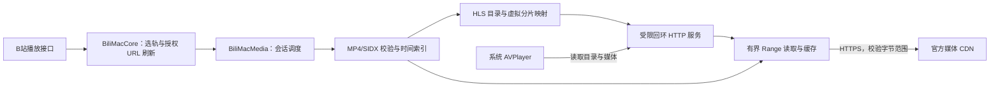

# BiliMac 自研播放桥设计方案

版本：提案 1.0 · 日期：2026-10-29 · 代码基线：`3bf1581`（BiliMac 0.5.0）

状态：设计基线，0.6.0 已实施首阶段增量，具体状态见文末。后续阶段仍为设计目标。

## 1. 目标与产品边界

自行实现 BiliMac 的媒体适配和传输层，最终替换 `Vendor/BiliKitCore`，使播放桥的源码、测试素材、接口和维护节奏由本项目掌握。视频仍由哔哩哔哩官方播放接口与 CDN 提供，权限仍以当前账号和官方响应为准。

系统 AVPlayer / AVKit 继续负责解码、音画同步和原生播放控件；本项目负责把官方返回的音视频资源组织成它可消费的播放资源。使用苹果系统框架符合本方案的“自研”边界；目标是移除现有第三方播放实现，而非重写操作系统的解码器。

首版直接消费当前播放接口的 SegmentBase 初始化区间和索引区间，不建设完整 MPD/XML 与所有 DASH profile 的通用解析器。

首版覆盖当前 macOS 26+ 的普通点播：H.264 + AAC、手动清晰度切换、拖动进度、分 P、倍速、暂停恢复、历史续播和现有小窗。HEVC 作为随后验证项；HDR、杜比、自动码率、多音轨、直播、离线下载、AirPlay 接收端播放和 iOS 不纳入首版承诺。窗口全屏与应用内小窗不等于 AirPlay。

自研价值是可控的诊断、缓存、取消和恢复策略，随后再根据实测优化起播与资源占用；不预先声称比现有桥更快、更省电。

## 2. 当前仓库需要替换什么

以下来自本次仓库检查，不是未来实现进度：

| 现有位置 | 当前作用 | 自研替换内容 |
| --- | --- | --- |
| `Package.swift` | 依赖本地 BiliKitCore 的 BiliModels / BiliNetworking / BiliPlayback；桥内还依赖 BiliApplication | 新增本项目的 BiliMacMedia target，最终移除整项 package 依赖 |
| `Sources/BiliMacCore/Models.swift` | PlaybackManifest 使用外部媒体表示类型 | 自有轨道、范围、索引、能力与播放描述模型 |
| `Sources/BiliMacCore/BilibiliClient.swift` | 播放接口字段映射、外部 CDN URL 策略 | 保留本项目 API 适配，改为自有模型和独立 URL 校验 |
| `Sources/BiliMac/PlayerController.swift` | 调用 DASHToHLSBridge，持有 PreparedPlaybackAsset，控制 AVPlayer | 注入自有 PlaybackPreparing，持有自有播放会话 |
| `Vendor/BiliKitCore` | MP4/SIDX 索引、HTTP Range、HLS、回环服务和支持模型 | 按公开格式规范重新实现所需子集，不逐文件搬运 |
| `Tests/BiliMacTests/Fixtures` | 两段合成 MP4 也来自参考项目 | 用本项目生成器重新生成音视频和边界数据，记录生成参数 |
| `Scripts/build-app.sh`、`SettingsView.swift`、`THIRD_PARTY.md` | 打包并显示现有第三方许可 | 全量替换并核验后，按新版本实际内容更新；过渡版继续准确说明来源 |

现有搜索、用户、收藏、评论、登录、历史、弹幕业务无需整体重写。WBI 签名已经在本项目的 `WBISigning.swift` 中；它是 API 协议适配，不属于本次播放桥的替换接口。

## 3. 传输路径选择

### 3.1 推荐路径

推荐先为当前 macOS 开发版实现：**自有 DASH/fMP4 索引解析 → 内存 HLS → 虚拟媒体分片 → 受限回环 HTTP → AVPlayer**。

它负责索引与容器适配，首版不重新编码音视频，也不把整部影片预先下载到本机。只有实际确认不符合 HLS 容器约束的资源，才单独评估容器重封装，不能默认“DASH 换一个 m3u8 就必定能播放”。

HLS 中的初始化段、媒体分片和独立音轨组织以 [RFC 8216](https://www.rfc-editor.org/rfc/rfc8216.html) 为依据；MP4 结构以 [ISO/IEC 14496-12](https://www.iso.org/standard/85596.html) 为依据。W3C 的 [ISO BMFF 字节流说明](https://www.w3.org/TR/mse-byte-stream-format-isobmff/)可辅助理解初始化段与片段结构，但它的 MSE 约束不能直接当成 AVPlayer 的完整兼容保证。

### 3.2 必须提前解决的取舍

苹果的 [HLS Authoring Specification §10.3](https://developer.apple.com/streaming/hls-authoring-specification-for-apple-devices.html) 建议避免通过本地服务器交付媒体。因此回环路线是当前点播适配的工程取舍，不能称为完全符合苹果所有交付建议，更不能据此承诺上架或 AirPlay 兼容。

`AVAssetResourceLoader` 可参与资源加载，但不能假定它可以接管所有 HLS 媒体字节。苹果工程师在 [相关技术讨论](https://developer.apple.com/forums/thread/113063) 中说明过 HLS 分片加载的限制；历史讨论也不能替代 macOS 26 的实际验证。

| 路线 | 收益 | 主要代价/未知点 | 决策 |
| --- | --- | --- | --- |
| 自有 HLS + 回环 HTTP | 可以控制必要请求头、Range、取消、诊断；接入当前 AVPlayer 较直接 | 苹果交付建议的取舍、本地服务资源与安全边界；AirPlay 另测 | 当前开发版推荐，必须先过 M0 |
| AVURLAsset / 原生轨道组合，或 ResourceLoader + CDN 直取 | 有机会减少本地服务，更多传输交给系统 | 分离远程轨道能否持续流播、请求头、拖动、内存和切换是否满足需求均需原型证明；ResourceLoader 不是通用 HLS 字节代理 | M0 同时验证；通过同一矩阵后可优先采用，不能先承诺可替换 |
| 服务端重新包装为标准 HLS | 客户端交付接近常规 HLS | 新增服务器、流量费用、媒体与账号边界及运维 | 本轮不引入 |
| 自行驱动 VideoToolbox / AudioToolbox 渲染 | 对帧与时钟控制更深 | 需自行承担同步、缓冲、音频输出、渲染及系统集成 | 超出当前桥接目标 |

M0 是路线选择门槛：若虚拟分片、fMP4 或系统加载限制无法满足基本点播，先调整路径，再展开完整工程；不以复制旧桥的补丁作为解决方案。

## 4. 建议架构

以下为推荐路径的目标结构，所有 BiliMacMedia 内部模块均待独立实现。

代码依赖保持单向：`BiliMac → BiliMacCore → BiliMacMedia`，应用也可直接使用 BiliMacMedia 的播放接口。BiliMacMedia 不导入 BiliMacCore、SwiftUI、账号管理或用户业务；需要刷新媒体描述时，通过协议回调交给 BiliMacCore，避免循环依赖。

建议起初只创建一个自有 target，内部按目录分层，待形成稳定复用边界再拆包：

| 模块 | 责任 | 输出/约束 |
| --- | --- | --- |
| MediaTypes | 轨道、字节区间、媒体身份、能力、起播位置 | 不暴露第三方类型；时间使用整数刻度/有理数 |
| SourcePolicy | 官方媒体主机、HTTPS、重定向与请求头边界 | 精确域名/受控后缀匹配，禁止任意 URL 代理 |
| RangeReader | 按需读取、响应校验、取消和背压 | 返回有限数据流与已验证元数据，不整片读入内存 |
| ISOBMFF | box 遍历、init 校验、SIDX v0/v1、时间/范围映射 | 有界读取、溢出检查，暂不支持的结构明确失败 |
| HLSPresentation | 构造主目录、音频/视频目录与虚拟资源表 | 原子发布不可变 VOD 快照，属性与实际轨道一致 |
| LocalTransport | Network.framework 回环监听与最小 HTTP surface | 只服务本会话已登记资源；会话关闭即撤销 |
| StreamSession | 请求代次、缓存、失效恢复、事件与关闭 | 每播放项独立身份；旧任务不得更新新播放项 |

对应用暴露的概念接口：`prepare(播放请求, 媒体刷新器) → PreparedStream`。PreparedStream 提供播放 URL、会话 ID、诊断事件和显式 `close()`；URL 与关闭句柄由同一 owner 管理。底层实现可以更换传输路径，应用不依赖 SIDX 或本地路由细节。

## 5. 从点击播放到出画面的流程

1. BiliMacCore 请求同一 bvid/cid 的播放描述，依据账号可用范围选择一条视频和一条音轨；首版不把多种画质同时交给系统自动切换。
2. BridgeSession 创建请求身份，校验候选 URL，并行读取必要 init/index 字节。只把固定的媒体请求头交给网络层，不传入 SESSDATA、CSRF 或任意账号 Cookie。
3. 独立解析 init 与 SIDX：检查实际 box 边界、timescale、track ID、时间原点、媒体长度及样本描述。每段的字节范围必须以 SIDX 的真实文件位置为基准，不能误把 index 响应的局部偏移当绝对偏移。
4. 生成视频目录、音频目录和主目录；保持各轨原始时间轴，不假定音视频段数、段长或起点完全相同。只有兼容时才发布为同一呈现。
5. 将媒体段登记成虚拟小文件，例如 `/session/<随机令牌>/video/seg-12.m4s`，映射到源 MP4 的有限字节范围。登记完成后才向 AVPlayer 公开入口 URL。
6. AVPlayer 请求某虚拟分片时，RangeReader 只取其源范围并流式转发。音画同步与解码由 AVPlayer 完成；应用按正常播放项状态展示加载、暂停、播放与失败。
7. 跳转、切 P、切画质和 URL 失效按会话代次处理；替换播放项时显式释放旧会话。普通页面切换/小窗继续复用同一 AVPlayer。

“没有转码”不等于“没有兼容性处理”：若需要修改 MP4 容器，应有单独的格式证明、实现与测试；不能无依据修改品牌、解码参数或关键帧标记。

## 6. 最容易出错的工程细节

### 6.1 索引与音画时间轴

- 支持 SIDX v0/v1、32/64 位字段、多个前置 box 和非零 first_offset。偏移/长度使用有溢出检查的运算；timescale=0、截断、越界、空数据、间接索引和异常引用数必须有确定结果。
- 初期只接受直接媒体引用；间接 SIDX 或缺失索引返回明确“不支持该媒体结构”，不猜测分段边界。
- 校验 ftyp/moov 与必要片段结构、轨道 ID、解码时间和数据寻址，不能只凭扩展名判定可播放。
- 时长、时间原点和 seek 目标用统一时间模型转换，精度误差有上界；不按“第 N 段”强行对齐音视频。
- 不凭一个 SAP 标志就生成 I-frame playlist；首版不生成该可选目录。独立分段标签仅在媒体条件获得证明时使用。

### 6.2 虚拟分片与 HTTP Range

虚拟分片相对于“把整部远端 MP4 原样代理到本地”更易限制范围：它允许一个不带 Range 的 GET 安全返回一个有限分片，HEAD 返回该虚拟文件元数据。若 AVPlayer 在虚拟文件内继续请求 Range，需把局部偏移平移回源文件，并返回相对于虚拟文件的 Content-Range。

HTTP 单范围、206 和 416 的语义以 [RFC 9110 §14](https://www.rfc-editor.org/rfc/rfc9110.html#name-range-requests) 为依据。工程上必须额外校验上游 Content-Range 的起止与完整长度、实际收到字节数及内容类型。上游忽略 Range 返回 200 时，不能把整片正文冒充一个片段；正文不足、超出或被压缩而改变字节语义时失败。传输开始后失败就关闭当前响应并上报，不能在半个响应后偷偷拼接另一 CDN 的正文。

分片响应允许上游省略 Content-Length，但不能省略范围身份和实际字节数验证。Content-Type 为通用二进制类型时，只在已验证对应 MP4 初始化结构的前提下接收，拒绝 HTML/JSON 错误页。

初期下游只支持 GET/HEAD 与一个 Range；多范围请求采用明确、已测试的拒绝策略。临时路径只能映射已登记媒体，不接受 `?url=任意地址`。

### 6.3 网络、缓存与失效恢复

- 采用有背压的数据流：下游发送完成后再继续读取，避免异步序列背后仍无限堆积。
- 初期任务与缓存按会话隔离；将来共享下载时使用独立租约/引用计数，关闭一个播放会话不能取消其它会话仍需要的下载。
- 仅缓存校验完整的 init/index 和媒体片段；key 包含 bvid/cid、表示/codec、范围及内容版本信息，不能只按 URL 或 BV 缓存。失败/取消的半段不进入成功缓存。
- 起步预算：缓存上限 64 MiB、全会话在途请求上限 4、数据块目标 64 KiB；均为待压测配置，不是已经达到的性能指标。媒体片段超预算时流式交付而不强行整段缓存。
- URL 失效时由 BiliMacCore 对同一媒体身份执行一次合并刷新；需要重建时保存当前位置和暂停意图。不能把权限拒绝、区域限制或官方验证解释为“应该绕过”。
- CDN 备用地址只在验证媒体身份后使用。首版固定每轨已验证的来源；跨来源信息不一致或无法证明内容一致时重建会话，不把不同版本/码率的缓存拼起来。
- 对允许重试的短暂读取错误限定次数，例如同一资源最多 2 次；对校验错误、官方限制和重复失败停止自动重试，留出用户操作入口。

### 6.4 切换、取消与关闭

会话状态建议为：`创建 → 解析 → 已发布 → 服务中 → 关闭`，错误可从任意准备/服务阶段进入；重试创建新的请求身份。暂停是播放器意图，不必销毁媒体会话。

切画质保存 bvid/cid、位置、播放/暂停、倍速；准备新资源后先核验请求身份，再替换播放项。旧索引、旧网络响应、旧“ready”事件和旧错误不得作用于新项。关闭需撤销路由、取消在途任务和等待队列、终止连接及监听器；幂等 close 是主路径，deinit 仅兜底。

### 6.5 本地服务与可诊断性

只监听 `127.0.0.1` 随机端口，校验 Host 和不可预测会话路径；限制请求头大小、连接数、等待时间与单次媒体范围。拒绝请求体、路径穿越、重复/冲突头和未登记路径；不暴露源签名 URL，不向其它网卡开放服务。令牌是附加保护，不等于对其它本机进程的绝对隔离。

诊断记录包括阶段耗时、范围校验错误、队列长度、重试次数、缓存命中率和 AVPlayer error/access log 的脱敏摘要。完整 URL、查询签名、账号凭据与本地令牌不进入普通日志。诊断只在本机，不新增遥测服务。

## 7. 专属于 BiliMac 的演进方向

基础点播通过后，再分别验证以下能力：

1. 根据当前时间和 seek 意图安排下一段读取，拖动后立即取消过期预取，避免机械下载到片尾。
2. 以分 P 与轨道版本为单位共享成功缓存，切画质时复用确实相同的音轨，内容身份不符则隔离。
3. 用户可打开“播放诊断”，看到问题发生在官方描述、索引、CDN 读取、本地交付还是系统解码，失败提示能指向可执行的重试/切画质操作。
4. 独立扩展字幕、兼容性重封装、HEVC 与多音轨；性能变化通过同一批样本与旧版基线比较。

这些是可验证的工程特色，不以自研名称代替速度和稳定性的证据。

## 8. 分阶段实施与迁移

| 阶段 | 产出 | 进入下一阶段的门槛 |
| --- | --- | --- |
| M0 路线原型 | 自造 fMP4、少量真实媒体；虚拟 HLS/回环及可行的原生直取路径验证记录 | AVPlayer 实际出画面、音轨可听、seek/取消可用；明确非标准交付取舍与不支持项 |
| M1 独立基础 | 自有模型、URL 策略、Range、MP4/SIDX、HLS 和自造素材生成器 | 格式/HTTP/异常测试和真实 AVPlayer 合成媒体集成通过 |
| M2 应用接入 | 注入 PlaybackPreparing，新旧实现仅在开发构建中选择 | 起播、暂停、续播、分 P、画质、倍速和小窗回归通过；切换不会调用错误后端 |
| M3 稳定性 | 有界缓存、取消、错误恢复、诊断、资源预算 | 快速操作、弱网、URL 失效与长时间播放满足验收矩阵 |
| M4 完整替换 | 自研成为发布路径；移除 Vendor/BiliKitCore、旧类型和第三方测试素材 | 全新 checkout 无旧依赖可构建；应用资源与代码审计、文档及关于文案一致 |

保留旧实现只作为迁移阶段的开发对照。最终的“完全替换”版本不包含自动回退到旧桥的隐藏路径；上线发现问题可回退到旧的发布版本，并继续展示那个版本原有的来源说明。

在 M0 得到样本覆盖和实现规模后再估算工作量，不承诺未经验证的固定工期。首轮代码落点建议先做 MediaTypes、RangeReader、SIDX 与合成播放闭环，不先堆叠缓存、HDR 或复杂网络调度。

## 9. 独立实现与来源管理

- 本次设计核对了旧依赖和实现边界，设计作者已经接触旧源码。因此目前可以承诺的是“依据规格重新实现的目标”，不能宣称已经完成严格的净室实现。
- 未来实现应以本方案、公开标准、接口样例及本项目自造素材为输入，避免把旧桥源码、旧补丁和旧测试向量直接带入实现任务。若要求严格净室流程，需分离规格编写、未接触旧实现的实现者与来源审查，并保留过程记录；仅新开一个聊天不能证明净室成立。
- 不复制、逐句改写或翻译旧实现；不把改文件名、类型名或版权头称为独立开发。公共协议与 API 字段可以成为功能契约，规范中的示例代码也不直接搬运进产品。
- 原有两段 MP4 不只是测试数据的占位名称，它们有明确上游来源。用自写生成器和苹果媒体框架生成新素材，记录参数、版本、摘要和生成步骤；包括带可辨识声画标记的片段，便于检验同步。生成器可用 AVAssetWriter 输出分片并为实测文件布局生成索引；数值黄金样例与系统解码校验应独立，避免生成器和解析器复用同一错误算法而相互“证明正确”。
- 替换完成前准确保留现有版本随附的许可说明。最终按实际仍包含的代码、素材和协议参考更新 THIRD_PARTY、打包脚本、设置文案与依赖清单；不改写旧提交/旧发布包的历史记录。

## 10. 验收矩阵与发布条件

下列是拟定验收目标，尚未执行：

| 方面 | 必测场景 | 通过条件 |
| --- | --- | --- |
| 解析 | SIDX v0/v1、64 位、非零偏移、截断/溢出、未知 box、间接索引 | 确定输出或明确错误；不崩溃、不越界、不猜范围 |
| HTTP | 206/416、忽略 Range 的 200、短/长正文、重定向、无 Content-Length、取消、慢消费者 | 字节与资源长度正确；有界缓冲；不会整片读入内存或混入错误正文 |
| HLS | 初始化段、音视频目录、实际 codec、不同分段边界/时间原点、虚拟文件局部 Range | 目录与媒体一致；AVPlayer 可真实解码，不能只比较字符串 |
| 播放 | 自动播放关闭、拖动至头/中/尾、暂停后切画质、续播、分 P、倍速、小窗往返 | 位置与用户意图保持；无误报暂停为卡顿、无旧任务覆盖 |
| 同步 | 自造声画标记、至少 30 分钟连续播放、seek 后恢复 | 声画偏差目标不超过 100 ms；用可测信号或媒体时间戳证明，不仅观察进度条 |
| 稳定性 | 20 次快速切换；20 次开关；断网/恢复；URL 失效；退出 | 无僵尸任务、泄漏监听器和无限重试；资源释放可观察 |
| 性能 | 同一设备/网络/20 条点播样本，新旧版本交替测量 | 记录首帧 p50/p95、卡顿时间、流量和进程内存；首帧 p95 目标≤5秒且较旧版退化≤10%，预先定义样本与排除条件 |
| 内存 | 热播放、seek、反复开关、长视频 | 自研缓存/队列遵守配置；进程整体内存与 AVPlayer 开销分开测，关闭后没有持续增长趋势 |
| 独立性 | 干净构建、源码/资源/依赖图及应用包检查 | 无旧 package import、旧桥二进制/许可资源的误打包及上游测试素材；来源说明与实际内容相符 |

真实接口验证使用公开可播放内容和本人有权访问的媒体；自动测试不读取钥匙串、不花费账号余额或执行互动写入。官方风控/权限失败单列为受限检查，不计为完整播放通过。最终发版前人工验收系统控件、全屏、小窗、音量和实际可听音轨。

## 11. 当前决策建议

同意技术方向后，应从 M0 与自造媒体闭环开始，先证明当前真实资源能由独立实现稳定交付给 AVPlayer，再逐层替换旧依赖。到 M4 的独立性验收完成，设置页才适合改为“播放桥接由 BiliMac 自主实现，基于系统 AVFoundation”。

本提案未提前修改该文案；当前 0.5.0 中的第三方说明仍然准确。

## 12. 0.6.0 首阶段实施状态（2026-10-29）

- 已建立 BiliMacMedia，默认播放器使用自有 MediaTrack/ByteSpan、Range/SIDX、HLS 虚拟分片与回环会话；Package.swift 不再依赖外部包，无旧桥自动回退。
- 已通过自造媒体 AVPlayer 画面/时钟、音轨选择/读取和暂停拖动验证，并已用无凭据真实公开视频验证画面与时钟。PCM 解码、HTTP/会话边界及完整回归记录见 IMPLEMENTATION.md。
- 首版固定 H.264/AAC；每次读取最多 16 MiB，媒体交付并发 2，采用有界整片段缓冲；尚未实现方案中的细粒度流式读取、缓存、URL 刷新和中途 CDN 切换。
- 初始化只做顶层格式/长度检查；SIDX 只支持直接引用。完整 fMP4 语义、HEVC、长时间同步与性能指标未全部验收。原生直取/轨道组合路线尚未比较，M0 只证明当前回环路径可用。
- 自造像素/PCM 经外部开发工具 FFmpeg 编码为新素材；不同于原计划仅用苹果框架生成的选项。FFmpeg 不进入构建或运行依赖，CI 直接读取已提交新素材。
- Vendor/BiliKitCore 暂作历史参考保留并附许可，不构建、不链接。不能据此声称整个仓库已无第三方内容，也未宣称严格净室。项目根 MIT 许可未修改。

M0/M1/M2 的基础闭环已落地；M3 稳定性与优化、M4 最终来源清理及完整发布验收仍有工作。本文的目标表不是已达成指标。
